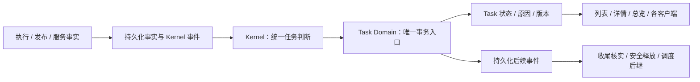

# 任务状态简化：技术落地方案

- 日期：2026-10-22。
- 状态：源码实施与评审修复已验证；完整安装/发布验收未关闭。实际结果见[修复记录](2026-10-22-task-state-review-fixes.md)。
- 产品目标：[任务状态简化设计](2026-10-22-task-state-simple-design.md)。本文是该设计的技术细化，不建立第二套任务规则。
- 现状依据：本地工作区源码，包含尚未提交的结果接受、公开交付和受管服务实现；不是仅依据 HEAD。
- 架构边界：[ADR-0020](../adr/0020-core-module-ownership-and-dependency-direction.md)、[ADR-0022](../adr/0022-unified-kernel-control-plane-and-decision-ledger.md)、[ADR-0023](../adr/0023-durable-kernel-workflow-recovery-and-availability.md)、[ADR-0032](../adr/0032-result-first-delivery-and-completion-certification.md)、[ADR-0037](../adr/0037-multi-conversation-task-parallelism.md)。实施批准前，现行 ADR 与[当前状态契约](../current/task-lifecycle-state-contracts.md)仍是现行系统依据。
- 完成日期：2026-10-22（源码实施与定向/全量回归，未安装、未发布）。
- 关闭提交：无；当前为未提交工作区，用户未要求提交或发布。
- 实施记录（唯一入口与验证证据）见本文第 9 节。

## 1. 技术核心只有三件事

**一份任务结论，一个事务入口，一条安全放行链。**

1. `Task.status` 直接保存六个状态；Kernel 根据操作事实使用同一个纯函数判断任务结论。
2. Runtime 通过 Task Domain 的唯一入口提交状态、原因、版本和后续事件；所有客户端读取这份已提交结论。
3. 执行、发布、交付、启动服务都有持久化结果；现有调度器在确认旧操作安全停止后，原子释放名额并预约后继。

继续使用现有 Kernel inbox、Decision/application、outbox、Attempt receipt、发布记录、服务操作记录和会话调度器。内部记录提供事实，不再各自推导一份 Task 状态。



### 1.1 本方案补全的两个边界

- **执行途中只剩等名额时，回到排队。** 若没有运行操作、没有有界重试，剩余工作已经准备好却缺少容量或资源名额，安全停下后允许 `running → queued`。这是“排队”的既有含义在中途让出名额时的应用，补全目标图未画出的边，不增加状态。仍需评审通过后实施。
- **任务结论与安全清理分开。** 端口冲突可以立即落为失败；如果还有已确认需要停止的本任务进程，另显示“正在清理”，暂时保留名额。终态不因清理进度而变回执行中。无法核实的已知残留继续隔离，不能改写既有终态。

## 2. 现状与必须一起改造的入口

以下是已经从源码确认的结构问题；不将每一项等同于已经复现的用户故障。

| 现有入口 | 当前事实与风险 | 落地动作 |
| --- | --- | --- |
| `src/core/types.ts`：`TaskStatus` | 持久化八态为 `created/ready/running/parked/blocked/done/archived/cancelled`，没有 `failed` | 替换为六态；归档改为独立时间字段 |
| `src/task/task-engine.ts`：`VALID_TRANSITIONS`；`task-lifecycle.ts`：`TASK_TRANSITIONS` | 两张表分别检查原始状态与 canonical 状态，合法转换集合不同 | 只保留 Task Domain 一张六态转换表 |
| `task-lifecycle.ts`、`task-user-state.ts`、`task-view.ts` | 原始状态、八态 lifecycle、四态 userState 和展示 phase 共存 | 删除 Task 的近似生命周期映射；View 只组装状态及操作详情 |
| `task-lifecycle-transition-port.ts`：`createTaskLifecyclePort()` | 已有统一 seam，但记录只在内存中；不足以保证状态、原因、版本和 application 同事务 | 在此收敛为持久化领域提交入口，保留 Subtask 独立入口 |
| `src/task/task-runtime-service.ts`、`src/storage/task-repo.ts` | `updateTask(Partial<Task>)`、通用 `update()` 仍可携带 status | 通用更新类型排除生命周期字段；状态 SQL 仅供事务 port 使用 |
| `src/execution/kernel-execution-runtime.ts`：结果接受/重试分支 | 有恢复到 `ready` 后直接进入 `running`、发 dispatch 的路径 | 接受只提交决策并入队；发布、执行必须再次验证 slot |
| 同文件：`startRequestedPublishedService()` | 发布 drain 外围启动服务；部分失败分支仅 appendOutput | 服务启动纳入必需工作与规范化操作结果，不靠输出文本维持状态 |
| `task-cancellation-coordinator.ts`：`completionBlockedReasons()` | 混合实际运行残留与 `managed_service:health_required` 业务未完成条件 | 拆开“是否完成要求”与“是否能安全放行”两个问题 |
| `src/execution/task-residue-reader.ts` | 已统一多类残留，但尚未覆盖完整的服务启动、接管及清理证据 | 扩展现有 reader，禁止各处另写残留判断 |
| `src/account/account-startup-recovery-service.ts`：`convergeConversationSlots()` | 依赖 `done/archived/cancelled/blocked` 等旧值决定释放 | 改为六态与安全事实；启动与周期恢复调用同一收敛服务 |
| `src/kernel/task-scheduler.ts`；`src/storage/conversation-task-scheduler-repo.ts` | 两处可见候选排序；slot claim/release 需要增加任务版本与预约轮次校验 | 排序统一由现有 Kernel policy 决定，Repo 只原子应用授权结果 |
| `src/storage/pending-task-result.ts` | 通过旧任务状态、Subtask 和 receipt 选择待处理结果 | 排除已接受的精确结果，返回当前有效事项，不让历史 receipt 恢复按钮 |
| `src/storage/task-activity-facts-repo.ts`、`src/gateway/task-view-facts.ts` | 从运行事实重新计算展示结论 | 事实查询保留给 Kernel/诊断；主状态直接来自持久 Task |
| `src/workspace/conversation-activity-projector.ts` | 再调用 `deriveTaskLifecycleState()` 判断会话活动 | 只聚合已提交 Task 六态及独立的名额占用事实 |
| Session、commands、background delivery、Web/TUI | 仍有按 raw status 生成计数、操作、完成文案的消费者 | 全量替换，特别禁止“既非 blocked 也非 cancelled 就算 completed” |

实施第一个提交前，把所有读写点登记到实施记录，按“生产者、事务、恢复、调度、消费者、测试”逐项勾选。搜索范围包含 SQL/JSON、protocol mirror、测试 fixture 与安装脚本；不能只搜索 TS 中的 `TaskStatus`。

## 3. 一份模型与一套判断规则

### 3.1 Task 只持久化六个状态

```ts
type TaskStatus =
  | 'queued'       // 排队
  | 'running'      // 执行中
  | 'needs_action' // 待处理
  | 'succeeded'    // 成功
  | 'failed'       // 失败
  | 'cancelled';   // 取消
```

`TaskStatus` 的定义归 Task Domain；`src/core/types.ts` 可以在调整公共类型依赖后重新导出，消费者不复制枚举。保留 Subtask、Attempt、服务和租约的自身状态；本次不要求它们使用 Task 六态。

| Task 持久字段 | 内容 |
| --- | --- |
| `status` | 唯一 Task 状态；数据库 CHECK 限定六值 |
| `state_version` | 从 1 开始单调递增；状态、当前原因、有效操作或清理摘要改变均递增 |
| `state_detail_json` | 有界结构化当前原因、阶段、待处理事项、下一唤醒时间、清理摘要及证据引用 |
| `completed_at` | 首次进入终态时写入，之后不重置 |
| `archived_at` | 独立的归档属性，不改变成功/失败/取消 |
| `retry_of_task_id` | 后续重试任务指向原任务；原任务状态不改 |

沿用既有 account/conversation/workspace/generation 身份与审计字段。`state_detail_json` 不能接收自由拼接的日志或隐藏推理；限定数量、长度和允许字段。

当前原因使用稳定 `code`，例如 `port_in_use`、`command_not_found`、`retry_exhausted`、`result_acceptance_required`、`input_required`、`external_outcome_unknown`、`no_authorized_driver`。主要原因与其它未解决事项一起保存，避免“一个 reason 字符串”覆盖多分支事实。

阶段仅描述当前动作，例如 `executing/publishing/delivering/starting_service/retrying/stopping`，没有自己的转换表。待处理原因不伪装成执行阶段；终态主文案只由 `status` 决定。清理摘要可以附在任何适用状态下，不覆盖 Task 结论。

### 3.2 一张转换表

| 当前状态 | 允许目标 | 条件 |
| --- | --- | --- |
| 创建 | `queued` | 完成任务与授权工作要求的原子入库；不生成半个任务 |
| `queued` | `running` | 已获得本会话 slot，有持久化且有启动期限的可执行操作 |
| `queued` | `needs_action / failed / cancelled` | 排队期间新发现缺输入、确定失败或用户取消；不能要求先假装运行 |
| `running` | `queued` | 只剩等容量/资源；操作已安全停止，重新进入调度 |
| `running` | `needs_action / succeeded / failed / cancelled` | 按统一汇总规则判断 |
| `needs_action` | `queued` | 阻塞已解决，存在可推进工作；其余局部待处理事项仍可保留 |
| `needs_action` | `cancelled` | 用户取消 |
| 三个终态 | 不允许改变状态 | 明确重试新建关联 Task；归档、清理进度可同态更新 |

同态提交用于原因、操作或清理进度变化；相同幂等键重复提交不增加版本。被动核实到的外部结果先保存证据；若任务已停止在待处理，用户确认后重新排队，再由工作链收尾，不从待处理偷偷完成任务。

### 3.3 只有一个任务汇总函数

在 `src/task/task-lifecycle.ts` 中替换原 Task 映射，提供纯函数 `evaluateTaskState(facts)`。Kernel 是它的策略调用者；Gateway、恢复 Worker、服务管理器不各自调用它改状态。

输入是当前授权图、必需工作结果、可推进分支、明确的 retry budget/wake、待处理事项、取消 fence、slot 与操作身份。时间由 snapshot 传入，函数不查库、不读时钟、不解析日志。

判断顺序：

1. 已是终态：维持原结论，只允许补齐审计及清理事实。
2. 已提交用户取消 fence：取消，授权停止未完成操作，拒绝新业务副作用。
3. 有实际运行的业务操作、有界自动恢复，或已获名额的可推进工作：执行中。独立分支继续，局部问题一并展示。仅为已确定结论停止残留进程不算新的业务工作，不因仍在清理而推迟已确定的失败结论。
4. 必需工作已确定失败且没有本轮恢复：失败，保留其它成果。
5. 未失败，但必须由用户解决事项才有进展：待处理。
6. 全部必需要求已完成：成功；安全收尾仍由放行协议核实。
7. 存在已就绪工作、只差执行名额，且无未收尾操作：排队。
8. 以上均不成立：明确系统异常；存在安全不确定性进入待处理，已证实无未知副作用且执行链不可完成则失败。禁止默认执行中。

“可推进”不包含被失败依赖挡住的分支，也不包含只存在于内存中的回调。失败依赖使下游不能执行；不因此终止其它独立分支。必需分支失败后，停止无意义的未来工作，并记录停止原因。

### 3.4 成功依据授权工作要求

在现有 `work_graph_revisions` 增加 `completion_requirements_json`，与该版本授权一起持久化。它只是“本版本必须完成哪些工作”的清单，不再维护一套操作状态表。

清单编译自通过验证的 Planner proposal、现有 Subtask `acceptance/fileOutputs/deliveryKind` 和显式 `startServiceAfterPublish`。当前图节点按必需工作处理；本轮不扩展任意 optional 分支协议。Runtime 不通过用户原句或日志关键词补猜启动意图。

| 必需项 | 完成证据 |
| --- | --- |
| 执行产出及验收 | 当前授权 Attempt/结果对象；认证通过，或有针对该结果的有效接受决定 |
| Git 集成与文件公开交付（适用时） | 对应 integration commit、delivery checkpoint、文件清单及 hash；不能只看 Subtask done |
| 安全报告交付（适用时） | 已持久化的 Result Object 及该交付目标要求的 durable delivery 结果 |
| 启动本地服务（用户明确要求时） | 精确 serviceId/规格/操作轮次的启动成功、健康检查及服务管理器接管记录 |

服务是必需项时，工作链明确为：执行 → 集成 → 公开交付 → 启动/健康检查 → 接管 → Task 成功。没有启动要求的任务不加这一项。客户端是否在线不成为任务完成条件；远端投递如为明确交付目标，则以对应 delivery 结果为准。

重规划必须生成新要求快照，保留旧版本；不得为了完成 Task 丢掉尚未满足的用户要求。减少要求需要用户授权的范围变更，沿用现有部分结果接受控制路径并留审计。

## 4. 唯一事务入口怎样落地

### 4.1 扩展现有 TaskLifecyclePort，不新建控制平面

Task Domain 暴露 `applyTaskChange(command)`，替换现有 `transitionTask/blockTask/unblockTask/parkTask/resumeParkedTask` 对 Task 的分散状态修改。下面是拟议接口，名称在实现时可按仓库风格微调，语义不可拆散：

```ts
interface ApplyTaskChange {
  taskId: string;
  decisionId: string;
  operationKey: string;
  expectedVersion: number;
  generationId: string;
  graphRevision: number;
  to: TaskStatus;
  detail: TaskStateDetail;
  evidenceRefs: readonly TaskEvidenceRef[];
}
```

初始图授权尚未物化时，用该授权 Decision 的确定性 Task/图身份完成创建，不伪造 active revision。普通元数据更新改用显式类型，排除 status、version、detail、completedAt 等受保护字段。

增加一张窄表 `task_state_changes`：保存 `task_id/version/operation_key/decision_id/from/to/detail_json/evidence_refs_json/created_at`。它同时提供持久审计、精确用户决策的证据引用与投影通知源，不承担第二套调度。约束 `UNIQUE(task_id, version)`、`UNIQUE(task_id, operation_key)`；创建和迁移基线也有记录。接受证据索引包含 actionId 与完整结果身份，pending-result 查询可据此排除已解决事项，不扫描整段历史日志。

### 4.2 同一次提交的边界

复用 `KernelWorkflowRepo` 的事务能力，通过 Storage adapter 实现一个同步 Unit of Work；领域层只依赖 port，不 import SQLite。一次**数据库内的状态应用**在同一事务中：

1. 优先查询幂等记录；同键同载荷返回首次提交结果，同键不同载荷拒绝。
2. 校验 Decision 身份、当前 Task 版本、活动图及授权配置；重新检查支持此转换的事实、取消 fence、结果身份与 slot token。事实已变化就回滚并重新送 Kernel 决策，不在 Runtime 换一个目标状态。
3. 执行必要的本地领域事实更新：只解决明确列出的待处理项、写入续跑 payload、阻止新 dispatch 等；禁止批量把所有 dependencies 标为 resolved。
4. 条件更新 Task 状态、detail、version；写 `task_state_changes`。
5. 将本次数据库动作的 application 标记 applied；写必要 Kernel 观察事件及持久化投影/调度通知。
6. 提交后 Worker 读取通知执行后续动作；内存推送失败不影响 durable 结果。

当前 `DurableKernelWorkflow` 是 `runtime.apply()` 返回后再调用 `markApplied()`，因此**只把 TaskRepo 更新包一层事务还不够**。需增加数据库动作的原子提交 seam，让 workflow 能识别已经提交的 application；保留外部动作的异步执行模式。重复 `markApplied` 只能按同一 observation 身份幂等确认，不能再次生成事件。

外部进程/Git/文件系统动作不放进 SQLite 事务。先提交已有操作意图和身份，再执行，再提交 checkpoint/结果及 Kernel 事件。操作结果入库与该事件原子提交；Kernel 后续更新 Task 有异步间隔，期间展示原已提交结论，后台负责有界收敛。不能声称跨进程副作用与 Task 结论是一个原子动作。

### 4.3 接受结果的完整链路

每条待处理事项有稳定 `actionId`，携带 task/generation/graph/subtask/attempt/result 精确身份、可选动作和对应安全条件。沿用 `safe-result-identity.ts` 的归属及安全校验，不把“用户接受”当作绕过路径安全检查。

1. 客户端提交 `actionId + expectedResult + expectedVersion + idempotencyKey`。
2. Gateway 的 accepted receipt 仅表示请求已接收；只有 application 提交后才返回“已接受，已排队”或“已接受，仍有其它事项待处理”。
3. Kernel 校验当前结果与可接受条件。Task port 原子记录精确接受决定、解决该事项、保存续跑 payload。不能此时运行 `stageAcceptedResult()` 的外部副作用。
4. 无其它阻塞且工作可推进时进入 queued；仍有必须先解决的事项时保持 needs_action。若其它独立分支本就在运行，Task 保持 running，仅更新局部事实。
5. 调度获得名额后执行 `stageAcceptedResult()`、发布及后续必需工作；每步检查当前 reservation、generation、取消 fence。
6. 后续失败独立记为当前失败原因。旧 receipt 的 `uncertified_result` 保持不可变；接受决定存于新审计记录和原 Decision，不把 receipt 改成 certified。

`readPendingTaskResult()` 必须查询尚未被有效决定解决的结果，不能仅因 Subtask 仍未发布就恢复按钮。多个结果使用多个 actionId；处理 A 不代表 B 已处理。旧页面提交过期结果返回 `stale_action` 并携带当前快照；重复同一请求返回原决定及最新快照，不再接受新结果。

### 4.4 重试与取消

- **待处理上的重新执行**：只解决指定事项，保存有权限且可安全执行的续跑动作，重新排队；原 receipt 保留。不因按钮点击直接启动 Attempt。
- **终态任务重试**：创建 `retry_of_task_id` 关联的新 Task，保存明确授权的未完成要求与输入引用。通过当前 artifact/handoff 校验复用已交付成果，验证权限、hash 和必要的公共目录基线；不复制旧 Subtask done 冒充新执行成功。只补启动服务时，要求中显式绑定原公开目录和 serviceRef，由 Kernel 校验新 Task 对该资源的操作授权，不伪改原 manifest 的 taskId，也不把新 Task 身份直接套进旧服务操作。
- **取消与完成竞争**：两者使用版本 CAS；取消先提交 fence 则所有后续完成/启动被拒绝，Task 为 cancelled 并持续安全清理；完成先提交则取消返回“任务已经结束”。用户已收到取消应用成功后，晚到完成不能改为 succeeded。
- **服务后续操作**：已接管常驻服务的健康变化、`/service` 显式控制不复活原 Task；如果用户要完成旧失败任务的剩余目标，走关联新 Task。已成功交付的服务只有任务还在启动阶段且由任务拥有时才属于该 Task 的收尾对象。

## 5. 操作结果、清理和队列使用同一条链

### 5.1 操作统一上报事实，Kernel 统一决定下一步

复用 `KernelFailure`、Attempt receipt、publication/delivery 状态与 `managed_local_service_effects`；在领域边界输出一致的结果结构：`operationId`、类型、授权身份、结果证据、`success / definite_failure / unknown`、错误 code、是否有未确认副作用。不同记录不用强行改为同一张表。

每个可恢复操作都要能回答：是否有结果、是否可安全重复、下一驱动何时发生、何时停止本轮自动尝试。授权尚未实际启动的操作也要有启动期限，不能以 pending 状态无限占住任务。

| 情况 | 唯一策略 |
| --- | --- |
| `EADDRINUSE`、命令不存在、已知不可恢复的交付错误 | 确定失败；必需工作失败时 Task 失败，不等待用户，不自动换端口 |
| 临时网络/基础设施故障，已证实重复安全 | Kernel 在现有配置预算内授权重试；保存次数、绝对截止时间、下一 wake；执行中显示重试进度 |
| 重试预算耗尽，已知无未知外部结果 | 失败；不能再转成泛化的 blocked/待用户 |
| 用户材料或授权缺失 | 待处理，列出具体补充/确认入口 |
| 外部执行超时，无法确认是否已生效 | 有界查询核实；仍不明则待处理并保留必要隔离，不盲目重试 |
| 进程已确认退出、结果明确失败 | 按确定失败处理，不能仅因曾发生 timeout 就永远待核实 |
| 运行态没有有效驱动 | 恢复先补查 durable checkpoint；无法恢复则形成明确异常结论及原因 |

自动重试继续使用现有 Kernel retry policy 和 `retry_wakes`，不新增 Runtime 重试策略。生产配置中的次数与时间上限进入 revisioned snapshot；任何无限/缺省无界预算拒绝授权。业务执行不新增粗暴的统一总时长限制；这里限制的是重试、启动、健康检查、清理和核实等有界阶段。

### 5.2 服务启动失败必须落库

`ManagedLocalServices` 保留服务管理职责，改为输出结构化结果。端口探测保留原始错误码：只有 `EADDRINUSE` 是端口占用，不能把所有 listen 异常统一翻译成端口冲突。探测与真正 bind 之间可能竞争，进程退出和启动日志仍需补充规范化事实。

- 服务操作意图先写入已有 effect；包括启动前检查失败，也必须有可追溯的失败结果。
- 健康检查达到 `startupTimeoutMs` 仍不健康：记录 `service_health_timeout`，停止本次任务启动的进程；检查停止结果。不能一直保留“等待健康”作为任务完成 blocker。
- 进程身份、规格和健康检查共同证明启动成功；外部碰巧有同端口服务返回 200 不能算本任务启动成功。
- 健康通过后，服务管理器持久确认接管，才算启动要求完成。服务进程和端口占用归服务管理器管理；Task 的执行容量与临时租约在安全交接后释放。
- 无效/缺失的必需服务规格属于执行契约失败；用户未提供必须的外部凭证则待处理。按结构化原因分类，不通过 catch 中的提示文字决定。

### 5.3 一个安全判断，不混入业务完成条件

扩展 `TaskResidueReader`，为执行、发布、后端、WorkUnit、资源租约、Replan、retry wake、Kernel application、receipt、服务操作/清理提供同一组安全证据。

关键区分：**服务未启动成功是业务失败；本任务的进程还没停才是阻止放行的残留。** 前者决定 Task 结果，后者决定何时可以执行后继。不再把 health_required 加进物理残留列表。

| 残留类型 | 处理方式 |
| --- | --- |
| 有进程/写文件/正在发布/正在停止 | 原 Worker 收尾；持有 slot，展示正在清理及具体对象 |
| 可能已经发生的未知副作用 | 走现有 postcondition inspector 核实；不能以超时或改状态为由清锁 |
| 只是未来工作，没有正在发生的副作用 | needs_action 时撤销自动驱动并保存续跑点；不能永久算作正在执行 |
| 已接管常驻服务 | 不属于 Task 执行残留；仍以服务资源身份参与后续冲突检查 |

进入 needs_action 时，尚未发出的 retry wake 标为 superseded，未运行的 Replan 请求以原 owner 的 cancelled checkpoint 收束并保存继续所需 payload；活动 Planner claim 必须 fencing 并确认终止。恢复时由新授权轮次重新创建驱动，不重新启用旧 token。已进入未知状态的 application 必须按后置条件解决，不能为了释放 slot 批量改 applied。

清理、核实有明确期限。超过期限仍有事实不明：显示具体对象、失败动作和核实入口，slot 标记 recovery_blocked，停止无限自动重试；不删除资源事实。不相关会话按 ADR-0037 继续工作，共享资源冲突仍由 lease gate 拦截。

### 5.4 释放与后继预约的事务

现有 `ConversationTaskSchedulerRepo` 增加 slot 单调 `slot_version`；每次预约使用新的 reservationId，不能只由 conversation/task 拼出固定 ID。旧任务再次排队时，旧轮次 Worker 必须失去启动资格。

放行调用不得传入在事务外计算的 `hasResidue = false` 作为最终依据。Storage Unit of Work 内读取 Task 当前版本、slot 与统一安全事实，执行：

1. 校验 Task 是 needs_action、终态，或已经授权让出名额的 queued；核对预期版本、当前 slot owner 和预约 token。
2. 重新确认无残留；有残留则更新清理信息，不释放。
3. 原子释放旧 slot、收束该轮 schedule entry，并应用 Kernel 选出的后继预约；检查后继仍 queued、无取消 fence，且账户容量/资源条件仍有效。
4. 同事务写持久化 scheduler wake、投影通知；需要更新 Task 清理摘要时通过同一领域 port 同态提交新版本。
5. 提交后才由 Runtime 启动后继；启动前重新核对预约、授权、任务状态及资源租约。崩溃后按同一预约恢复，至多产生一份有效 dispatch。

没有可用容量时允许只释放，持久 wake 交由现有账户调度器稍后选择；不强求每次 release 必须立刻启动另一个任务。

同会话顺序沿用当前非抢占调度：接受后重新入队，刷新本轮排队时间，排在该会话已有等待任务之后，不沿用旧 Task 年龄插队；重复点击不再次改变位置。跨会话继续使用 priority/aging/fairness 与账户容量。由 `selectTaskDispatches()` 保留唯一排序规则，Repo 不再单独实现另一套规则。

发布和服务启动同样需要 Task slot，但可能不需要 Executor Attempt 名额。扩展现有 scheduler candidate 的可推进操作类型和资源需求，不能用 `runnableAttemptCount > 0` 将“只剩发布/启动”的任务永久排除，也不为它们新增第二个调度器。

## 6. 客户端、恢复与迁移一起切换

### 6.1 一个 Task 快照，所有产品表面共用

升级 Task View 查询为 `task_view_v2`，移除 Task 的 raw/lifecycle/userState 三份近似结论，直接提供：

```ts
interface TaskStateSnapshot {
  taskId: string;
  status: TaskStatus;
  stateVersion: number;
  reason: TaskReason;
  phase: TaskOperationPhase | null;
  pendingActions: readonly TaskPendingAction[];
  cleanup: TaskCleanupSummary;
  nextWakeAt: string | null;
}
```

具体操作历史、Subtask、成果、服务信息继续在详情 DTO 中，不因简化 Task 状态而删掉。服务后续健康变化走服务版本，不回写已完成 Task 的当前业务失败原因。

- 列表、详情、历史任务、工作区计数、CLI、Feishu 和 TUI 均消费此快照；共享状态标签表和按钮能力，客户端不按日志生成状态。
- `task_projection` 与 `task_view_snapshot` 携带相同 Task 版本；Web/TUI 用 `(accountId, taskId, stateVersion)` 拒绝旧覆盖，重复版本幂等合并。同版本冲突需要重新查询，不能随机选一个。
- Conversation `sequence/asOfSequence` 仍用于事件流补齐，不替代 Task 版本。Task 快照在一致读事务中组装；不能拼出旧状态加新原因。
- 断线恢复取当前 Task 快照再按水位补增量；慢 HTTP 回包、历史页或晚到 final_answer 均不能覆盖较新的 Task 状态。
- Conversation/Turn 保留自己的活动与交互状态，但只聚合/引用 Task 结论。回答已结束不代表 Task 成功，待处理任务与正在清理的失败任务也不能算成两个执行 Task。
- 工作区目录继续使用现有 durable invalidation/rebuild，保存来源 Task 版本与目录事件水位；旧 invalidation 只触发读最新值，不携带旧结论覆盖缓存。
- 不保留客户端 raw fallback。通过 Gateway hello capability 与更新流程阻止旧客户端消费新契约；旧持久事件只作为历史事实，当前结论重新关联 Task 快照。

同时更新 `src/gateway/`、`web/src/api/types.ts`、vendored `anyfusion/gateway-protocol.ts` 与 TUI protocol adapter/reducer；Desktop 是共享 Web 客户端的薄壳，验证安装包不能混装旧前端。

### 6.2 正常执行与恢复共用后置条件

保留 `kernel-application-recovery.ts` 的 inspector，但逐 action 更新后置条件，不再要求 Task 重新变 running/blocked/done 才证明旧动作成功。接收一次接受决定、获得 slot、执行一次发布是不同持久步骤。

| 中断位置 | 恢复后应做什么 |
| --- | --- |
| 接受事务前 | 未应用，可重发；不能显示已接受 |
| 接受已提交、通知未送达 | 根据已解决 actionId 和 queued/needs_action 快照补通知，不重复接受或清除其它事项 |
| slot 已预约、操作未启动 | 验证同轮 reservation 后启动；失效预约回收，不凭 Task=running 猜已启动 |
| 外部操作已发生、结果尚未入库 | 检查已有 receipt、commit/hash、服务 token/effect；可证明则补记，未知则核实隔离 |
| 操作结果与 Kernel 事件已提交，Task 未更新 | 重放同一事件，统一函数作出同一结论；不重新执行操作 |
| 失败已提交、清理未结束 | 保持 failed，完成收尾或明确 recovery_blocked；不能转为运行 |
| 旧 slot 已释放、后继已预约但没发出 | 从 durable 预约/wake 恢复，只启动同轮后继一次 |
| 新图或新任务已开始，旧完成消息到达 | 只保留原操作历史；身份/fence 校验阻止改动新图或新任务 |

启动与周期恢复调用同一个 account 收敛入口，覆盖所有未收束 application/job/reservation，不仅扫描 needs_action。已有授权校验、配置版本、资源分区和账户隔离保持生效；不为“恢复”开绕过权限的通道。

### 6.3 数据库和协议采用一次切换

当前工作区 schema 为 51、Kernel wire 为 v5、Work Graph proposal 为 v7、Task View 为 v1。实施时取当时最新基线递增，不在本文预占编号。新增 wire 字段/语义和持久 payload 的版本必须随迁移一起明确；旧库不能让新旧写路径同时运行。

迁移分两步，均在开始新任务前完成：

1. **停旧写入、核实外部事实。** 使用现有 upgrade/drain 流程停止新 admission，完成或停止正在运行的操作；写入可恢复检查点，确认旧 Worker 不再写库。无法核实的外部动作形成持久隔离记录，不能按“无进程”猜不存在。
2. **备份并迁移，再启动新规则。** 在一致数据库快照上生成逐任务证据分类报告；外部核实不放入长 SQLite 事务。迁移任务状态、当前 detail、版本、图要求、队列/slot token 和必要 payload，重建读模型；成功校验后启动新 Runtime。任一任务分类不明就保守待处理并隔离，迁移失败则不开放 admission。

| 旧记录 | 迁移依据 |
| --- | --- |
| `created / ready` | 确认已准入、无未知副作用且可推进时 queued；缺信息 needs_action |
| `running` | 有可核实有效操作或有界驱动时 running；安全停止且可推进时 queued；有明确失败证据 failed；无法核实 needs_action |
| `parked / blocked` | 按真实 blocker、retry/job 和操作证据分类，不能全映射为 needs_action 或 failed |
| `done / archived` | 完成证据完整则 succeeded；archived 额外设置 archived_at；若已有完整且确凿的必需项失败证据则 failed；无法确认则 needs_action，并保留旧终态及迁移异常审计 |
| `cancelled` | cancelled；仍核实残留，不把取消当作清理已完成 |

不得因旧数据缺少新字段便补造“服务已启动”等成功证据。迁移旧终态的异常分类属于唯一的离线证据修正，保留原值与依据；迁移后没有终态复活路径。历史用户接受必须匹配精确结果和 applied 决定，不能仅凭命令 accepted receipt 推断。

同步迁移/重建 active 查询、终态过滤、JSON blocker、pending-result SQL、schedule entries、当前图要求、Gateway snapshot、目录索引，以及 pending Kernel event/Decision 的版本处理。不可再执行的旧 pending action 要按已完成/安全补完/需核实分类收束，不直接拿旧 payload 运行新策略；不可变历史 ledger 保留原版本供审计，不作为新执行入口。

新增约束至少包括：六态 CHECK、非空原因/detail、正整数版本、终态与 completed_at 一致、transition 唯一键、Task 关联和会话 slot owner/token 一致性；建立账户/会话/status 与待处理事项的必要索引。在 SQLite 能表达的约束外，slot/Task 跨表不变量由唯一事务入口和恢复审计检查。

回滚只允许“停止新 Runtime 后恢复备份与对应旧 Runtime”，不能用旧程序打开新 schema。迁移后如已发生新外部副作用，需先收束并核实，不能只回滚数据库而丢掉现实操作。安装/升级沿用 ADR-0030 的可恢复升级流程。

## 7. 分三批实施，最终一次启用

三批是代码交付顺序，不是让不同模块在生产中长期采用不同状态。中间提交在隔离开发分支验证，最后通过统一迁移切换；不增加运行时双写兼容模式。

| 批次 | 具体文件与工作 | 出口条件 |
| --- | --- | --- |
| 一：统一状态入口 | `task-lifecycle.ts`、`task-engine.ts`、`task-runtime-service.ts`、`task-lifecycle-transition-port.ts`；Task/Kernel/WorkGraph 公开类型；`task-repo.ts`、`kernel-workflow-repo.ts`、`migrations.ts`；六态、要求清单、版本、审计、事务应用及数据迁移 | 转换表、幂等、CAS、取消竞争、数据库中断和证据分类测试通过；不再有公开通用状态写入口 |
| 二：统一工作链和放行 | `control-kernel.ts`、`kernel-execution-runtime.ts`、`subtask-attempt-runner.ts`、publication/delivery、`managed-local-service.ts`；residue reader、cancellation coordinator、application recovery、account startup recovery、scheduler/repo、account/session composition | 接受后排队、端口冲突失败、失败保留成果、清理后推进、未知结果隔离、发布/服务无 Attempt 调度、重试预算全部闭环 |
| 三：替换所有消费者并切换 | TaskView/activity facts、Gateway protocol/query/events、Session/commands/background delivery、Workspace activity/directory、Web/Desktop、vendored TUI、Feishu；安装升级、Docker、当前文档与旧文档清理 | 各端读取同一状态/原因/版本；无旧 fallback；升级、重启、断线及联动验收通过后才启用 |

### 7.1 必须删除的旧路径

- 删除 Task 的 `TASK_LIFECYCLE_BY_STATUS`、`toTaskLifecycleState()`、`deriveTaskLifecycleState()` 及第二张 Task 转换表；保留仍需要的 Subtask/Attempt 规则。
- 删除 `task-user-state.ts` 四态定义及所有 Task `userState/lifecycle` 重复字段；不保留隐藏 fallback。
- 删除接受/恢复后绕过 slot 的直接 running/dispatch 路径、宽泛 unblock-all，以及 TaskEngine 的旁路状态更新。
- 删除 TaskView、activity projector、前端、命令、background delivery 中自行猜 Task 成败的分支。
- 删除“服务不健康就一直当 completion residue”的判断，将业务结果与进程残留各归其位。
- 删除 scheduler Repo 中与 Kernel 重复的候选排序；Repo 保留原子约束和持久化应用。

### 7.2 文档只保留当前目标与当前契约

本轮保留原简化目标和本文技术细化，二者职责不同。实施时更新对应 ADR 的生命周期、恢复、完成与 slot 条款，并同步 `CONTEXT.md`、中英文 technical overview、`task-lifecycle-state-contracts.md`、命令参考；导航变更才调整 AGENTS。

2026-09-25 生命周期计划、2026-10-16 四态投影计划及相关缺陷记录届时不再作为执行指导：提取仍有价值的验收证据到当前实施记录，删除被替代的规则段；需要保留历史的移入 archive 并标注替代关系，纯重复草稿删除，修复所有入口链接。不能提前删除目前仍被 accepted ADR 引用的现行契约，也不能保留旧规则在 Current Docs 中与六态并列。

本次计划关闭时，记录完成日期、实际迁移/wire 版本、交付行为、测试与原生/安装证据、关闭提交。计划的技术决策如已完整写入当前契约，保留实施记录和引用，避免再维护一份平行规则。

## 8. 验收：每个场景都查完整链路

每个用例同时断言：**Task 状态/原因/版本、必需操作事实、slot/token、后继 dispatch 次数、各端当前快照与成果可见性。** 中间阶段可以有已记录的传输延迟，不允许依赖刷新页面或人工扫库才能收敛。

| 场景 | 必须看到的结果 |
| --- | --- |
| 接受未认证结果 → 代码交付 → 8788 端口冲突 → 8789 后继 | 旧 Task failed/port_in_use；已接受记录及代码仍可见；无残留后后继恰好启动一次；无旧接受按钮 |
| 用户只要求交付代码 | 不额外启动服务，交付成功即 succeeded |
| 接受后公开交付确定失败 | Task failed，保留执行成果；重试创建关联 Task 且只补交付 |
| 两项待处理原因 | 接受 A 不解决 B；独立工作仍可运行，所有可推进工作停止后才 needs_action |
| 分支 A 失败、B 可独立继续 | B 继续时 running 并展示局部失败；收束后 failed；失败依赖下游不执行 |
| 临时故障重试与预算耗尽 | wake/次数/截止时间持久化；截止后 failed，不无限等待 |
| 未知外部结果 | 有界核实后 needs_action；不能重复执行；冲突任务被隔离，其它会话正常推进 |
| 发布/服务续跑时没有 Executor 节点 | queued 能被现有 scheduler 选中，不受 runnableAttemptCount=0 永久阻挡 |
| 取消与成功、接受与取消同时到达 | CAS 决定唯一结果；取消已应用后不再启动，晚到完成不改终态 |
| 清理超时、停止失败 | 明确清理对象和原因；不释放有风险 slot，不隐藏活进程 |
| 常驻服务接管后继续新任务 | 原 Task 成功并释放 Task 名额；服务继续存在，后续端口冲突仍被正确识别 |
| 接受、结果入库、Task 提交、slot 释放、后继预约之间崩溃 | 重启恢复与正常链相同；已交付不重做、后继不重复启动 |
| 快照乱序、慢查询、重复事件、断线后连接 | 列表、详情、总览与 TUI/Feishu 当前值最终一致，旧版本不能覆盖新值 |
| 旧库升级、新客户端配旧 Runtime、旧客户端配新 Runtime | 分类可审计；版本不匹配明确阻止，不静默走旧状态规则 |

### 8.1 测试落点与运行门槛

优先扩展现有测试，而不是另建一套 mock 状态系统：

- 纯规则与持久化入口：`tests/task/task-lifecycle.test.ts`、`task-lifecycle-transition-port.test.ts`、`task-view.test.ts`，以及 `tests/storage/` 的 task/workflow/migration/scheduler 测试。
- 操作与恢复：`tests/execution/kernel-execution-runtime-recovery.test.ts`、`kernel-application-recovery.test.ts`、`task-residue-reader.test.ts`、`managed-local-service.test.ts` 和 publication/delivery 测试。
- 账户队列与跨端：`tests/account/account-startup-recovery-service.test.ts`、`tests/workspace/conversation-activity-projector.test.ts`、Gateway/Server/history 测试，Web 与 vendored TUI reducer/controller 测试。
- 完整案例：扩展 `tests/e2e/task-result-service-acceptance.test.ts` 和 publication recovery；用独立子进程在提交边界中断 Server，验证真实 SQLite checkpoint、真实预约和进程退出证据。

各批运行归属 seam 的定向测试。最终运行 lint/build、服务与 Web/TUI 相关套件、Docker SQLite/迁移测试及原生 smoke；用真实临时服务制造端口冲突、启动失败、健康超时和重启，覆盖原案例。Desktop 打包验证共享前端、Task View 版本协商及安装升级，不能把源码测试通过当作已安装生效。

通过这些门槛并删除旧状态判断后，才能将简化设计和本计划标为已实施。安装/发布是否完成另行记录，不能与源码完成混称。

## 9. 实施与评审修复记录（2026-10-22）

原始实施经评审发现接受绕过 slot、应用事务断点、证据误匹配、迁移误判与客户端
版本不一致等问题。原先“本次改造自身回归为 0”的结论不再作为完成依据。

完整交付内容、F01–F15 对照、真实进程故障注入、用户案例、全量测试和环境限制统一
记录在[修复与验收记录](2026-10-22-task-state-review-fixes.md)。

当前 schema 为 52，Task View 为 v2。核心源码修复已完成；安装包、Docker、真实
安装版 smoke 与全部 §8 崩溃检查点仍须独立验收，不能据此将整个发布计划关闭。
